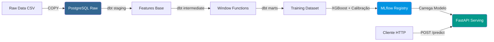

# Credit Scoring & Fraud Detection Platform


Uma plataforma end-to-end de detecção de fraude e credit scoring projetada para o mercado financeiro. O projeto cobre desde a engenharia de features temporais em SQL até o serving de um modelo calibrado via API, com infraestrutura testada e CI/CD.

## 📌 O Problema de Negócio

Instituições financeiras perdem bilhões anualmente com fraudes em cartões de crédito. O desafio não é apenas treinar um modelo preciso, mas sim construir um **sistema de priorização** que consiga lidar com o extremo desbalanceamento de classes (~3,5% de fraudes) e entregar probabilidades calibradas e acionáveis para o time de análise.

Este projeto utiliza o dataset **IEEE-CIS Fraud Detection** (competição do Kaggle com dados reais e anonimizados) para simular um ambiente de produção de ponta a ponta.

## 🏗️ Arquitetura da Solução

A arquitetura foi desenhada separando as responsabilidades de engenharia de dados, ciência de dados e engenharia de software.



## 🛠️ Stack Tecnológico
Engenharia de Dados: dbt-core (SQL), PostgreSQL 16.

Machine Learning: scikit-learn, XGBoost, imbalanced-learn (SMOTE), MLflow (Tracking & Registry).

Serving & API: FastAPI, Pydantic, Uvicorn.

Infraestrutura & Qualidade: Docker, Docker Compose, GitHub Actions (CI), Pre-commit (Ruff, SQLFluff), Pytest.

## 📊 Resultados e Métricas
O foco da avaliação foi o PR-AUC (métrica principal para classes desbalanceadas) e métricas operacionais reais de fintech (Precision no topo do ranking e calibração via Brier Score).

### Evolução dos Modelos (Validação)

| Modelo | PR-AUC | ROC-AUC | Brier Score | Precision@Top 1% |
| :--- | :---: | :---: | :---: | :---: |
| Baseline (Logistic Regression) | 0.131 | 0.758 | 0.150 | ~ 0.20 |
| XGBoost (Bruto) | 0.188 | 0.793 | 0.150 | 0.388 |
| **XGBoost + Sigmoid (Final)** | **0.198** | **0.795** | **0.031** | **0.396** |

Insight Operacional: Com o modelo calibrado, ao revisar o top 1% das transações mais arriscadas (fila de triagem humana), o modelo identifica fraude com ~40% de precisão (vs. 3.5% de uma escolha aleatória, um ganho de 11x em eficiência).

## 🧪 Decisões de Engenharia e A/B Tests (O que aprendemos)
O portfólio não é feito só do que deu certo, mas das decisões embasadas por testes:

Isolation Forest (Anomaly Detection): Treinamos um modelo não supervisionado para gerar um anomaly_score e adicioná-lo às features. O A/B test mostrou um delta de -0.0003 em PR-AUC. Decisão: Rejeitado. O XGBoost com árvores já captura as mesmas interações não-lineares, e a feature não entrou no top-15 de importância.

scale_pos_weight no XGBoost: Testamos balancear as classes no treino vs. treinar sem balanceamento e aplicar calibração depois. O modelo sem scale_pos_weight obteve PR-AUC de 0.1985 (vs 0.1881 com o peso). Decisão: Removemos o peso. A calibração Sigmoid já trata o desbalanceamento e o modelo fica mais conservador no topo do ranking (onde a decisão de negócio realmente acontece).

Prevenção de Data Leakage: O split do dataset é estritamente temporal (70% treino, 15% validação, 15% teste por data). Além disso, todas as janelas de tempo no dbt usam EXCLUDE CURRENT ROW para garantir que a transação avaliada nunca veja o próprio futuro.

## 🚀 Como Executar o Projeto
O projeto foi containerizado. Você precisa apenas do Docker instalado.
1. Clone o repositório
git clone https://github.com/Diego-Math1/credit-fraud.git
cd credit-fraud-platform

2. Suba os containers (Postgres + API FastAPI)
docker compose up -d

3. Verifique se a API e o modelo carregaram corretamente
curl http://localhost:8000/health

Esperado: {"status":"ok","model_loaded":true,"model_version":"latest"}

## Envie uma transação e receba a probabilidade calibrada de fraude:
  
O endpoint recebe os dados de uma única transação e retorna a probabilidade calibrada de fraude. 

**Exemplo: Transação legítima (Baixo Risco)**

```bash
curl -X POST http://localhost:8000/predict \
  -H "Content-Type: application/json" \
  -d '{
    "amount": 68.5,
    "txn_count_1h": 2, 
    "amount_sum_1h": 120.0, 
    "amount_avg_1h": 60.0,
    "txn_count_24h": 5, 
    "amount_sum_24h": 350.0, 
    "amount_avg_24h": 70.0,
    "txn_count_7d": 12, 
    "amount_sum_7d": 900.0, 
    "amount_avg_7d": 75.0,
    "amount_avg_last30": 65.0, 
    "amount_std_last30": 25.0,
    "amount_deviation_ratio": 1.05, 
    "amount_zscore_last30": 0.14,
    "seconds_since_prev_txn": 3600.0,
    "product_code": "W", 
    "purchaser_email_domain": "gmail.com"
  }'
```
Resposta esperada: 
```bash
{
  "transaction_id": null,
  "probability": 0.0070,
  "decision": "approve",
  "model_version": "latest"
}
```

## 🗄️ Detalhes de Engenharia de Dados (dbt)
O coração da extração de sinal está na camada intermediate (arquivo int_transaction_features.sql). Como o dataset não expõe o ID do cliente, construímos uma identidade sintética (card1|card2|card3|card5|addr1).

As features foram criadas usando Window Functions do PostgreSQL:

Velocity: Transações no último 1h, 24h, 7d.

Deviation: Valor atual vs. média das últimas 30 transações (ROWS BETWEEN 30 PRECEDING AND 1 PRECEDING).

Recency: Tempo em segundos desde a última transação do mesmo cliente (LAG).
## 🧪 Testes e CI/CD
O projeto adota o padrão de mercado de Integração Contínua:

Pre-commit: ruff (Python) e sqlfluff (SQL) rodam a cada commit local.

API CI (GitHub Actions): Sobe o ambiente, verifica a formatação, roda a suíte de testes (Pytest) e exige cobertura mínima de 70%.

dbt CI (GitHub Actions): Sobe um PostgreSQL efêmero e roda o dbt compile para validar toda a lógica Jinja e referências SQL dos modelos.

Testes dbt: Testes genéricos (unique, not_null) e singulares (ex: garantia de que txn_count_1h <= txn_count_24h).

## 📁 Estrutura do Repositório

A organização do projeto separa as responsabilidades de engenharia de dados (dbt), ciência de dados (notebooks) e engenharia de software (API).

## 📁 Estrutura do Repositório

A organização do projeto separa as responsabilidades de engenharia de dados (dbt), ciência de dados (notebooks) e engenharia de software (API).

```text
.
├── .github/workflows/    # Pipelines CI (GitHub Actions para API e dbt)
├── dbt_project/          # Modelos SQL (staging, intermediate, marts)
├── docker/               # Dockerfiles de produção (API e dbt)
├── mlruns/               # Artefatos e Registry do MLflow (modelos versionados)
├── models/               # Diretório reservado para artefatos de modelos locais
├── notebooks/            # Análise Exploratória (EDA) e prototipagem
├── reports/              # Relatórios e métricas de avaliação do modelo
├── scripts/              # Scripts utilitários (ex: load_ieee.py para ETL)
├── src/serving/          # Código da API FastAPI e Model Loader
├── tests/                # Suíte de testes automatizados (Pytest)
├── .pre-commit-config.yaml # Hooks de qualidade local (Ruff, SQLFluff)
├── .sqlfluff             # Regras de lint para os arquivos SQL do dbt
├── Makefile              # Atalhos para comandos comuns (setup, test, dbt)
├── docker-compose.yml    # Orquestração local (API + Postgres)
├── preprocessor.joblib   # Transformador serializado usado pela API
├── pyproject.toml        # Configurações do projeto (Ruff)
├── pytest.ini            # Configuração do framework de testes
├── requirements.txt      # Dependências de produção
└── requirements-dev.txt  # Dependências de desenvolvimento (testes, linters)
```
